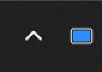
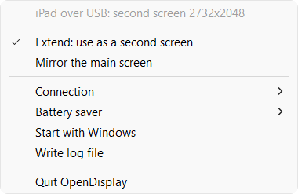
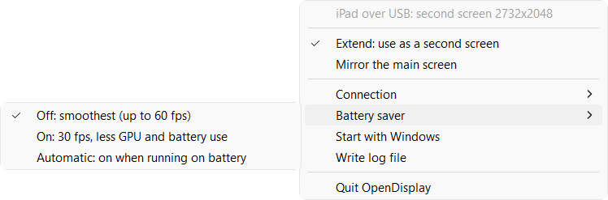

# OpenDisplay for Windows

**Use your iPad or iPhone as a second screen for your Windows PC.** Connect it
with a USB cable or over Wi-Fi, then drag windows onto it like onto any other
monitor. Touch, scrolling and Apple Pencil work on the device.

It works with the free **OpenDisplay** app ([opendisplay.app](https://opendisplay.app),
[App Store](https://apps.apple.com/us/app/opendisplay/id6780264891)), which so
far only had a Mac version for the computer side. This is the Windows side.

## Get started in 3 steps

### 1. Download and unzip

Download **OpenDisplay-Windows-x.y.z.zip** from the
[latest release](https://github.com/vhdlmike/opendisplay-win/releases/latest) and
unzip it to a folder you keep, e.g. `Documents\OpenDisplay`.

### 2. Install the virtual screen (once)

Double-click **`Install virtual display.cmd`** and click **Yes** in the Windows
prompts. This adds an invisible extra monitor to Windows, which the iPad then
shows. Without it, the iPad can only mirror your main screen.

> Windows may say *"Windows protected your PC"* because the app is not
> code-signed. Click **More info** > **Run anyway**.

### 3. Connect

1. Open the **OpenDisplay** app on the iPad/iPhone.
2. Plug in the USB cable, or stay on the same Wi-Fi as the PC.
3. Double-click **`OpenDisplay.exe`**.

After a few seconds the iPad becomes your second screen, and Windows shows a
notification. Arrange it left or right of your monitor in **Settings > System >
Display**, like any monitor; Windows remembers where you put it.

For USB, Windows needs Apple's device support, which comes with the
**Apple Devices** app from the Microsoft Store (or iTunes). Wi-Fi needs nothing extra.

## The tray icon

OpenDisplay runs quietly in the background. You'll find its icon next to the
clock (it may be hidden under the **^** arrow; drag it onto the taskbar to keep it visible).



| Icon | Meaning |
|---|---|
|  grey | Waiting for your iPad/iPhone. Open the OpenDisplay app on it. |
|  blue | Connected: the device is your second screen. |
|  amber | Connected, but only mirroring the main screen, or something needs attention. Hover over the icon to see why. |

Hover over the icon to see what it's doing, e.g. *"iPad over USB: second screen 2224x1668"*.

## The menu

Click the icon (left or right button) to open the menu:



| Menu item | What it does |
|---|---|
| *(first line)* | What OpenDisplay is doing right now. |
| **Extend: use as a second screen** | The iPad is an extra monitor. *(Recommended.)* |
| **Mirror the main screen** | The iPad shows a copy of your main screen. |
| **Connection** > Automatic | Uses the USB cable when plugged in (fastest), otherwise Wi-Fi. |
| **Connection** > USB cable only / Wi-Fi only | Only use that connection. |
| **Battery saver** > Off | Smoothest picture, up to 60 frames per second. |
| **Battery saver** > On | 30 frames per second and less work for the graphics chip: noticeably longer laptop battery life, the picture stays sharp. |
| **Battery saver** > Automatic | On while the laptop runs on battery (or Windows' energy saver is on), off when plugged in. |
| **Start with Windows** | Start OpenDisplay automatically when you sign in. |
| **Write log file** / **Open log file** | Keep a log for troubleshooting. |
| **Install virtual display driver...** | Only shown if step 2 is missing. |
| **Quit OpenDisplay** | Stop. The extra screen disappears and its windows move back to your main screen. |



## Everyday use

- **Leave it running.** When the iPad locks, the app is closed or the cable is
  pulled, OpenDisplay waits and reconnects by itself (switching to Wi-Fi if it can).
- **Touch** moves the mouse: tap to click, drag to drag. **Two fingers** scroll.
  **Apple Pencil** works as a pen, with pressure and tilt.
- **Text too small or too big?** In Settings > System > Display, select the extra
  screen and change **Scale**. OpenDisplay starts at 200% for Retina screens.

## If something doesn't work

| Problem | Try this |
|---|---|
| Icon stays grey | Open the OpenDisplay app on the device and keep it in front. For Wi-Fi: same network, and on the iPad allow *Settings > Privacy & Security > Local Network > OpenDisplay*. When Windows asks whether OpenDisplay may use the network, allow it. |
| Icon is amber and the iPad mirrors | Run `Install virtual display.cmd` again. It also repairs the virtual screen if it got stuck. |
| The iPad disconnects every second or two | Another computer or a second copy of OpenDisplay is connected to the same iPad. Only one can use it at a time. |
| USB not found | Install the **Apple Devices** app (Microsoft Store), unlock the iPad, and tap *Trust* if it asks. |
| Anything else | Turn on **Write log file** in the menu, reproduce the problem, then **Open log file** and include it in an [issue](https://github.com/vhdlmike/opendisplay-win/issues). |

**Uninstall:** quit OpenDisplay, double-click `Uninstall virtual display.cmd`,
then delete the folder.

**Privacy and security:** everything stays between your PC and your device.
There is no account and no cloud. The picture is sent unencrypted (like all
OpenDisplay apps today), so use the cable or a network you trust.

---

## For developers

opendisplay-win speaks the OpenDisplay wire protocol (`PROTOCOL.md`, pv 3)
through the upstream sans-I/O crates, so the stock receiver apps need no changes.

### Architecture overview

**Tray app:** `OpenDisplay.exe` (`src/bin/OpenDisplay.rs`, GUI subsystem) runs
the sender in the background with a notification-area icon showing the state
(grey waiting, blue streaming, amber mirroring/problem). Its menu covers
Extend/Mirror, connection (auto/USB/Wi-Fi), start with Windows, an optional
log file, driver install, and Quit, which detaches the virtual monitor first.
Settings live in `%APPDATA%\OpenDisplay\settings.json`. Both executables share
the library (`src/lib.rs`), and a named mutex allows only one sender per
session. The exes embed `assets/opendisplay.rc`: icons from
`packaging/make_icons.py`, version info, and a manifest requesting Common
Controls v6 (needed for `LoadIconMetric`) and PerMonitorV2. `build.rs`
compiles it with llvm-mingw's `windres`.

**Console:** `opendisplay-win.exe`:

Double-click `opendisplay-win.exe`: with no command it runs silently. It waits
for the receiver, streams to it, reconnects as needed, and stops when its
console window is closed, taking the virtual monitor down first. Pass
`--log [filter]` for a console log or `--log-file <path>` for a file; the
commands below are quiet without them, too.

The end-user package (`scripts/package.sh` → `dist/OpenDisplay-Windows-<version>.zip`)
contains the exe, the signed virtual display driver, `Install virtual display.cmd`
(runs `opendisplay-win install-driver`, which elevates itself and creates the
`Root\MttVDD` device via SetupAPI, with no devcon needed), and a plain-text README
(`packaging/README.txt`).

```
opendisplay-win list                      # receivers on Wi-Fi + USB, local monitors
opendisplay-win run                       # the receiver: over USB when cabled, else Wi-Fi
opendisplay-win run --to iPad             # by Bonjour name (or id fragment)
opendisplay-win run --to 192.168.1.162    # by address
opendisplay-win run --to usb              # over the cable (needs Apple Mobile Device Service)
```

When the device is both cabled and on Wi-Fi, the cable wins: lower latency
(about 3 ms vs 6 ms round trip) and a higher bitrate ceiling. It is checked on
every (re)dial, so pulling the cable continues over Wi-Fi. With a Bonjour name
(`--to iPad`), a USB device whose `hello` id doesn't match is skipped.
`--to <ip>` forces Wi-Fi and `--to usb` forces the cable.

Only one sender can drive a receiver: it always switches to the newest
connection. Two senders running at once take the device from each other
every second or two, and the log then warns about it.

Open OpenDisplay on the device first. Touch drives the mouse, two-finger
scroll drives the wheel, and Apple Pencil is injected as a Windows pen with
pressure and tilt. `Ctrl+C` stops. By default the sender exits when the app is
closed; `--stay` keeps waiting for it to come back.

#### Extended desktop vs. mirror

Windows only creates a monitor for a real display, so to *extend* the desktop
you need a virtual display driver. Without one, `opendisplay-win` mirrors the
primary monitor.

One-time setup (admin), tested with the signed MTT
[Virtual Display Driver](https://github.com/VirtualDrivers/Virtual-Display-Driver) 25.7.23:

1. Put `MttVDD.inf`, `MttVDD.dll`, `mttvdd.cat` (the "Driver Only" zip) and
   `vdd_settings.xml` in `C:\VirtualDisplayDriver\`. Add your device's panel
   resolution and its portrait version to `vdd_settings.xml`, e.g. 2224x1668
   and 1668x2224 for an iPad Pro 10.5". `run` logs the receiver's panel as
   `plan: panel WxH`.
2. `opendisplay-win install-driver` (asks for admin rights) copies
   `driver\*` next to the exe to `C:\VirtualDisplayDriver` and creates the
   `Root\MttVDD` device. `uninstall-driver` removes it. The package's
   `driver\vdd_settings.xml` (from `packaging/make_vdd_settings.py`) already
   lists current iPad/iPhone panels.

After that, plain `opendisplay-win run` (`--display auto`) does the rest on every connection:

- attaches the virtual monitor to the desktop (Win+P "Extend") if it is off or duplicated
- switches it to the receiver's desktop size (e.g. 2224x1668)
- sets its Windows scaling to the receiver's scale (200% for a Retina iPad)
- takes it off the desktop again when the session ends, so no windows are
  stranded on an invisible screen; Windows moves them back next time

The monitor stays where you arranged it in Settings > Display.

`--display DISPLAYn` streams a specific monitor as it is. Add `--resize true`
to switch it to the receiver's size for the session.
`--display primary` mirrors the main screen.

#### Command-line options

| Option | Meaning |
|---|---|
| `--scale mac\|passthrough\|<n>` | desktop size policy, as in the Linux sender (default `mac`: a 2x desktop for Retina panels) |
| `--max-fps <n>` | cap the frame rate below the receiver's panel rate |
| `--bitrate <Mbit/s>` | override the bitrate (default from resolution: 6–40 Mbit/s on Wi-Fi, 8–80 on USB) |
| `--software-encoder` | use Microsoft's CPU H.264 encoder instead of the GPU |
| `--log debug` | verbose logs; receiver telemetry is logged as `PHONE-STATS` |
| `--battery-saver` | 30 fps cap, 40% lower bitrate, fastest encoder preset, slower cursor polling |
| `--for <seconds>` | stop after a while (scripted tests) |

`opendisplay-win probe --display primary --out probe.h264` captures and encodes
60 frames to a file without a receiver, to check the capture and encoder.

### How it works

| Layer | Implementation |
|---|---|
| Protocol | the upstream sans-I/O crates `opendisplay-proto` + `opendisplay-session` (git dependency, pinned): framing, demux, `hello`/`welcome`, ping/pong, liveness, `kf`, cursor sequencing |
| Desktop/stream sizing | `src/desktop.rs`, vendored verbatim from the Linux sender (panel facts, H.264 L5.2 limits, `videoCaps`, 300 ms rotation debounce) |
| Discovery | mDNS `_opensidecar._tcp` (`mdns-sd`); USB via usbmuxd on `127.0.0.1:27015` (Apple Mobile Device Service) |
| Capture | DXGI Desktop Duplication (pointer excluded, sent as `cursor`/`cursorImg`) |
| Encode | D3D11 video processor (scale, BGRA→NV12, BT.709 limited) → Media Foundation H.264 hardware MFT (async, D3D11), Microsoft software MFT as fallback; High profile, low-latency, no B-frames, IDR only on demand, SPS/PPS on every IDR, 4-byte start codes |
| Flow control | at most 2 encoded frames queued; a slow link lowers the capture rate instead of dropping encoded frames |
| Virtual monitor | any IddCx virtual display driver; attach via `SetDisplayConfig(SDC_TOPOLOGY_EXTEND)`, mode via `ChangeDisplaySettingsEx`, scaling via the (undocumented) DisplayConfig DPI-scale info that Settings uses, detach on session end |
| Input | `SetCursorPos` + `SendInput` (touch, wheel), `InjectSyntheticPointerInput` `PT_PEN` (Pencil) |
| Battery saver | `desktop.max_fps` capped at 30, bitrate x0.6, `CODECAPI_AVEncCommonQualityVsSpeed` 0, cursor polled every 16 ms; the tray's Automatic mode follows `GetSystemPowerStatus` (on battery or energy saver) and `WM_POWERBROADCAST` |

### Building

Cross-compiled from Linux/WSL, no Visual Studio needed:

```
rustup target add x86_64-pc-windows-gnullvm
# llvm-mingw (https://github.com/mstorsjo/llvm-mingw) on PATH, for x86_64-w64-mingw32-clang
cargo build --release      # target set in .cargo/config.toml
cargo test                 # runs the Windows test exe (works from WSL)
```

The results are static executables in `target/x86_64-pc-windows-gnullvm/release/`
(`OpenDisplay.exe`, `opendisplay-win.exe`). `scripts/package.sh` builds the
release zip in `dist/`.

### Known limitations

- The UDP cursor side channel (§6.3) has not been acknowledged by the iPad in
  testing, so cursor positions fall back to TCP, as the spec requires. Over
  Wi-Fi the pointer can then lag behind large frames.
- No HEVC yet (`videoCaps` HEVC is ignored; H.264 is always offered by receivers).
- The bundled virtual display driver (MTT VDD 25.7.23) silently creates no monitor beyond ~85 modes, so
  `packaging/make_vdd_settings.py` keeps the list at 41 (one per panel size at 60 Hz).
- Per-monitor scaling uses an undocumented Windows interface. If a future
  Windows changes it, a warning is logged and the monitor keeps its scaling.
- The link is unencrypted, as with all OpenDisplay senders at pv 3. Use trusted networks.

### License

GPL-3.0-only, like OpenDisplay, from which the protocol crates and `desktop.rs`/`latest.rs` come.
